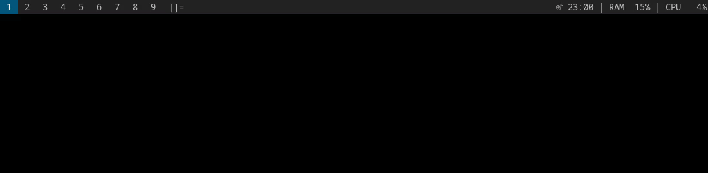
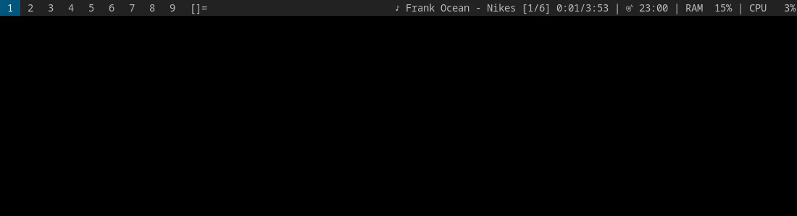

# music-menu

A dmenu music picker. Browse your music folder and play a track or a whole album with mpv in the background.

## Demo

The music library below is demo data.

**Browsing and playing**



**Playback controls**, pause, resume, next



## Features

- Browse folders, and play a single track or everything below a folder.
- Pause, next, previous and stop from the same menu.
- Shows the current track and its time in your status bar, see [dwm-status](https://github.com/sw1jari/dwm-status).
- Keyboard media keys through `mediakey`.
- Opens [spotify-menu](https://github.com/sw1jari/spotify-menu) when it's installed.

## Install

Needs bash, dmenu, mpv and socat.

```sh
cp music-menu ~/.local/bin/
mkdir -p ~/.config/mpv/scripts-music
cp now-playing.lua ~/.config/mpv/scripts-music/
```

## Usage

Run `music-menu`, ideally from a keybinding.

| Entry | What it does |
|---|---|
| `folder/` | Opens the folder |
| ▶ Play whole album | Plays everything below this folder in order |
| A track | Plays just that track |
| ⏯ ⏭ ⏮ ⏹ | Pause/resume, next, previous, stop (while playing) |
| 🎧 Spotify | Opens [spotify-menu](https://github.com/sw1jari/spotify-menu) |

Music is read from `/data/music`. Set `MUSIC_DIR` for another folder:

```sh
MUSIC_DIR=~/Music music-menu
```

## Status bar

`now-playing.lua` writes `$XDG_RUNTIME_DIR/music-now`, updated every second:

```
♪ Daft Punk - Digital Love [3/5]
1:23/5:01
```

The first line has the icon (♪ or ⏸), the track and its place in the album. The second has the time into the track and its length.

## Media keys

`mediakey` controls music-menu's mpv while it plays, and falls back to `playerctl` for other players. It also needs playerctl.

```sh
cp mediakey ~/.local/bin/
```

Bind it in your hotkey daemon, like sxhkd:

```
XF86AudioPlay
    mediakey play-pause
XF86AudioNext
    mediakey next
XF86AudioPrev
    mediakey previous
```
